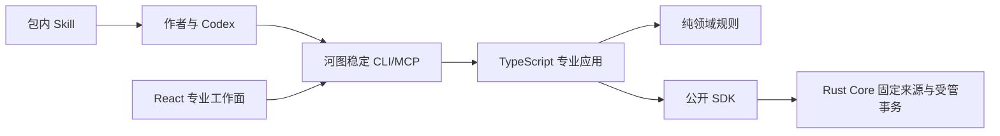
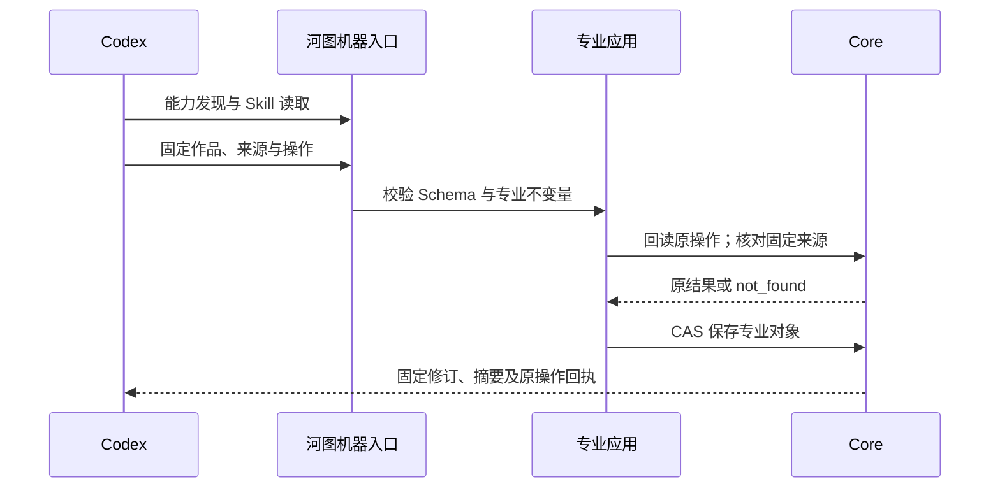

> 本文属于[小说审校文档](README.md)。

# 架构与领域设计

UI 与 CLI/MCP 消费同一应用动作；视图不拥有正文数据库。Core 以当前 WorkRef、插件 Owner、固定来源、CAS 和原操作持久化专业修订。插件不保存管理授权、密钥或运行时 Context。

领域对象保存在宿主受管文件中。索引为可重建投影，不新建第二份正文或私有数据库。停用和卸载停止新调用，历史由宿主通用导出继续保留。

## 专业边界

ReviewProject持有范围、六域检查、问题与配置。Coverage由每份固定来源与六域检查投影，不存第二份总分事实。纯规则检测不等价于Agent语义检查；检查结论标明依据，无法判断单独保留。问题候选引用宿主草稿，处理状态不会调用正文采纳。

领域层核验范围、证据、检查状态和问题生命周期；应用层通过公开SDK读固定来源与保存；视图负责导航和报告；Skill负责审读方法及后续修改编排。
