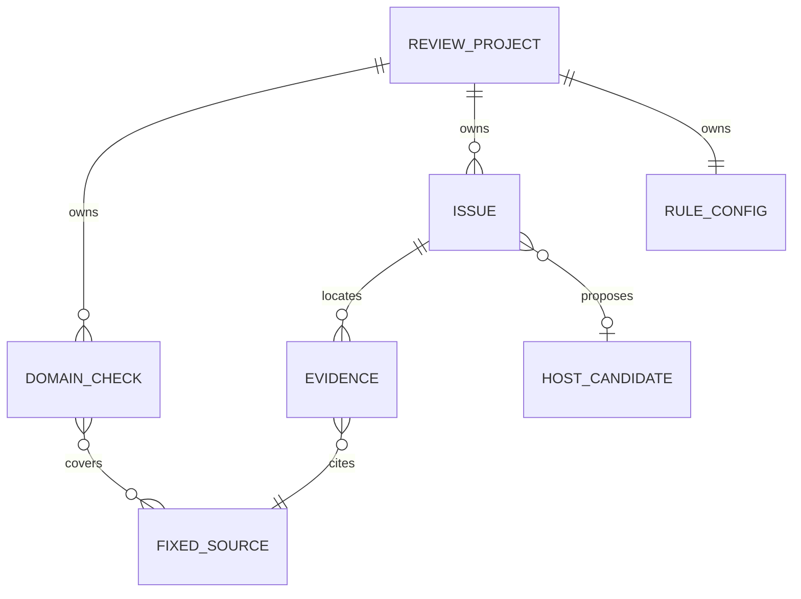

> 本文属于[小说审校文档](README.md)，拥有专业数据和动作设计。

# 数据与 API 设计

## 1. 数据结构

插件ID为 `org.wordflowlab.novel-review`，适用小说，专业类型为 `novel_review`。根对象包含format_version、title、framework_version、scope_indices、checks、issues、rules。source_refs由Core固定，所有专业引用使用不可重定向的source_index。

| 结构 | 主要字段及不变量 |
| --- | --- |
| Check | id、domain、status、source_indices、summary；domain为六域之一，status为unchecked／pass／finding／inconclusive；明确Agent报告来源 |
| Issue | id、title、domain、severity、description、evidence、disposition、candidate_source_index；不复制候选全文 |
| Evidence | source_index、byte_start、byte_end、quote；必须逐项对应固定原文，跨章问题可有多个依据 |
| Disposition | open／dismissed／resolved；处理说明与复核依据保留；resolved需要新固定来源与解释，不能由候选存在推断 |
| RuleConfig | 开启的规则、显式词项与阈值；文风项默认建议，不增加正文硬门禁 |
| Coverage | 根据请求范围与检查记录计算的只读投影；未做项不补默认pass |

## 2. 动作设计

| 动作 | 效果 | 用途 |
| --- | --- | --- |
| list_projects／get_project／save_project | read／read／managed_write | 分页查找、固定读取和完整CAS保存 |
| put_check | managed_write | 按确切域与来源维护检查结论，保留inconclusive |
| put_issue | managed_write | 新建或更新带依据的问题，不写正文 |
| set_disposition | managed_write | 明确忽略、恢复待处理或基于新来源复核解决 |
| run_local_checks | read | 对固定文本执行纯规则，返回带位置的诊断，不自动落成语义事实 |
| get_coverage | read | 展示六域与每份来源实际覆盖 |
| build_review_context | read | 返回固定来源、待检查项及相关问题，不重复生成已完成结果 |
| get_source | read | 回到方案声明的固定原文或设定 |
| compare_versions／export_project | read | 比较专业修订，导出固定报告 |
| get_operation | read | 原键查询 |

正式字段Schema由 `contracts/plugin-manifest.json` 拥有，操作地图由构建生成。经宿主 `hetu.plugins.invoke` 使用稳定工具，插件不提供独立网络服务或新MCP服务器。

## 3. 约束与恢复

新建expected_revision为0、expected_sha256为空；更新携带完整CAS和operation_key。旧来源只追加不替换。引文错误、范围越界、重复ID、检查覆盖不属于方案、候选引用不匹配均失败。

以新来源复核是新的专业修订；旧问题所在章节增加新版本时，旧报告仍解释旧版，不自动变为新版本已解决。未知结果按原键回读，CAS冲突保留原输入。宿主采纳、定稿和模型费用不由专业报告状态触发。
