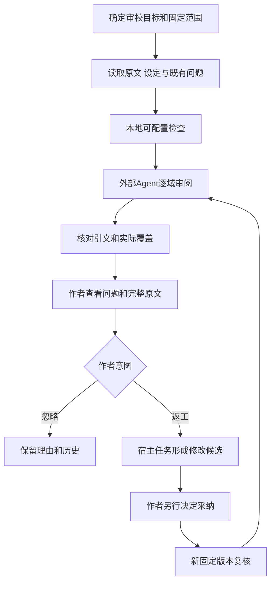

> 本文属于[小说审校文档](README.md)，定义业务流程和验收。

# 用户用例与验收

| 用例 | 必须验证的行为 |
| --- | --- |
| NRU-01 无报告 | 可按目标开始，六域显示未检查，不显示满分 |
| NRU-02 只审人物关系 | 其他五域保留未检查；报告不称整书通过 |
| NRU-03 跨章数字或知情矛盾 | 两端原文都有固定依据；仅有单端时依据不足 |
| NRU-04 作者提出问题 | 与Agent发现共同可筛选，明确来源与当前处理状态 |
| NRU-05 引文或UTF-8边界错误 | 拒绝保存假定位；不改写原文补齐依据 |
| NRU-06 本地重复检测 | 真正相同的段落返回每处位置；不判断人物一致性或作者身份 |
| NRU-07 文风偏好规则 | 可关闭、可忽略，分号或破折号不阻断正常保存 |
| NRU-08 没读到部分章节 | coverage明确列出缺口，不补全、猜测或记通过 |
| NRU-09 问题带修改候选 | 候选固定宿主引用；原问题仍待复核，正文不变 |
| NRU-10 原文变动 | 保留旧问题及坐标，重新关联新固定版本再复核 |
| NRU-11 忽略与撤销 | 留历史，可恢复待处理，不删除证据 |
| NRU-12 标记解决 | 要求新固定来源及复核说明；不能仅靠生成稿成功 |
| NRU-13 批次接续 | 先读已完成域与来源，补未做部分；来源修订不可混写 |
| NRU-14 CAS与同键冲突 | 明确拒绝，当前输入不丢失 |
| NRU-15 响应丢失与unknown | 原键先回读，不换键重复写入 |
| NRU-16 作品／Owner隔离 | 其他作品及错误插件对象失败；无整库回退 |
| NRU-17 同连接发现与Skill | 安装后可读方法、停用失效、重启用及升级重查 |
| NRU-18 CLI/MCP对等 | 双向保存和读取同修订、同摘要 |
| NRU-19 阅读与返回 | 按域、严重度、章节、状态筛选；打开原文后可回问题位置 |
| NRU-20 完整小说旅程 | 审查两章、发现矛盾、提交候选、接收作者意见、复核新版并继续下一章 |
| NRU-21 导出与卸载 | 固定报告范围和框架清楚；卸载不删除专业数据 |
| NRU-22 界面状态 | 浅暗、窄窗、键盘、空、错、冲突和unknown均实际运行验证 |

单元测试覆盖规则、证据与覆盖计算；真实Core集成验证来源、Owner、CAS及CLI/MCP；Electron和当前Codex会话验证完整任务。运行证据与未验证平台只登记08，不能用上游测试或Schema通过代替。

## 长篇专业深化

新增能力及兼容合同见[10-专业深度与升级验收](10-专业深度与升级验收.md)。字段以包清单Schema为准，专业动作与Skill由同包生成清单导航，实施及实际验证由08维护。
