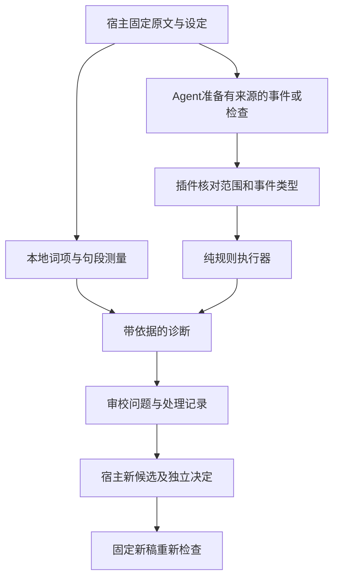
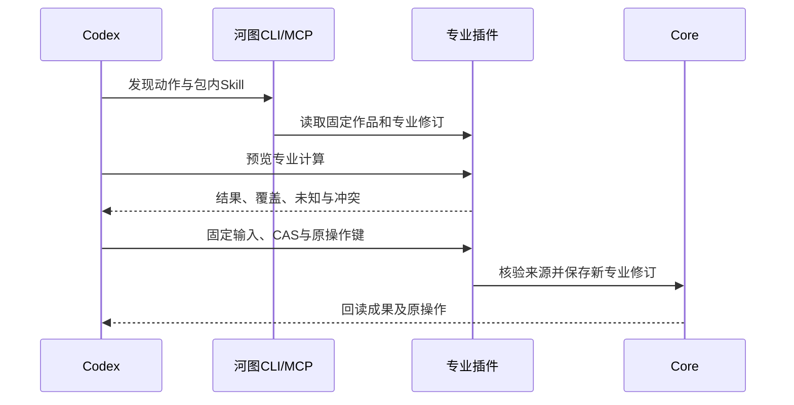

> 本文属于[小说审校文档](README.md)，定义专业深化合同；基础格式见[03](03-数据与API设计.md)。

# 专业深度与升级验收

## 1. 现状与目标

v0.1.0已具备六域检查记录、固定引文、来源覆盖、问题处理与新候选复核。静态审计核对`src/domain/model.ts`和`src/application/project.ts`：六域语义结论由外部Agent提供，本地`run_local_checks`仅执行配置词项与可选标点。记录框架可用，不表示已有完整中文校对或世界状态规则执行器。

深化目标是让每个问题能够说明：检查了哪些固定文本、使用什么规则、为什么报告、有哪些例外、修改以后如何复核。专业规则归插件，原文、正式设定、意见、候选和作者决定继续归宿主。进度唯一Owner为[08](08-实施计划与验收记录.md)。

## 2. 参考与取舍

| 参考 | 方法价值 | 边界 |
| --- | --- | --- |
| Openwrite／DSH-Creator | 多域框架、覆盖和本地规则 | 沿用有据框架；标点与文风只作建议，不阻止保存 |
| canonkeeper／dsh-story | 状态事件、来源和确定性约束 | 只检查已建立的事件；抽取不足不能推为整书一致 |
| dsh-novel-proofread | 中文校对任务与局部返工 | 词典版本、授权、误报与专名排除必须独立验证 |
| dsh-novel-quality-analyzer | 可解释指标及样本不足处理 | 所读实现面向英文词句，不能直接用于中文评分 |
| siweina/dsh-novel-writer | 中文句长与标点测量 | 仅为启发式；口径升级不得直接比较旧基线 |

扩展研究固定提交由河图插件29维护；本包已采用来源见[09](09-调研依据与设计决策.md)和[研究清单](research-sources.json)。本轮未执行上游规则或质量比较。

## 3. 分层与数据方案

规则执行器保持普通TypeScript纯函数，不依赖Cordis私有结构。运行适配层负责SDK读取、固定修订、预算和存取；外部Agent提供语义理解，不在插件中引入LLM循环。

以下结构定义专业深化模型，具体字段以包清单Schema为准。

| 结构 | 最小字段与不变量 |
| --- | --- |
| RuleSet | 稳定ID、版本、适用语言、规则清单、参数及词典版本摘要；固定运行不使用会漂移的“最新词典” |
| TextPolicy | 原始字节映射、分句／归一化口径版本、可选忽略范围；测量归一化不得改写原文 |
| StateEvent | 明确实体、事件种类、故事定位、状态变更、单位、证据及抽取状态；计划事件与已发生事件分开 |
| Assertion | 被比较事实、适用时间／叙事层、规则ID和版本、前提、例外与证据；不以名称猜身份 |
| Diagnostic | 规则、结果、相关来源范围、解释、计量口径、缺失前提及例外；建议不冒充正式事实 |
| RuleRun | 固定输入清单及摘要、规则集版本、实际检查范围、各类结果和不完整原因 |
| RecheckLink | 旧问题、旧运行、新固定来源、新运行及处理依据；旧结果保持旧版原义 |

单条规则结果区分`finding`、`pass`、`inconclusive`和`not_applicable`。未检查独立记录，不属于pass。报告总览汇总运行结果和覆盖，不把规则通过解释成整部小说没有问题。

## 4. 专业规则范围

| 能力 | 首次实施要求 | 不能据此推出 |
| --- | --- | --- |
| 精确重复 | 明确最短长度、比较范围、重叠去重与原始字节位置；报告各次出现 | 重复一定有错或作者抄袭 |
| 近似重复 | 显式启用、有版本归一化、相似依据；区分相似度与错误严重性 | 改写词序就构成质量问题 |
| 词项与专名 | 作者词表优先，异体／简繁／专名例外明确，建议带词典来源 | 未收录专名一定是错字 |
| 标点与句段 | 中文、英文、混合文本分别计量；保留对白、诗歌与排版例外 | 统计可以判断AI来源或文风优劣 |
| 物品与货币 | 交易、赠予、借还、损坏、单位换算及已知起点 | 起点未知等于余额为0；不同单位可直接相加 |
| 人物状态 | 伤势、位置、死亡／假死／复生的有据变化 | 提及人物等于人物实际到场 |
| 时间与知情 | 基于明确顺序和信息传递；倒叙、梦境、分支及不可靠叙述分开 | 章节顺序等于故事顺序；读者知道等于人物知道 |

先交付精确重复、词表与有限状态规则；近似匹配和复杂时间推断分别设专业门槛，不一次实现通用逻辑语言。规则参数使用类型化结构，不能让作品数据执行任意JavaScript或Python。

## 5. 动作与兼容

所有动作仍经河图稳定CLI/MCP转发，实际参数以当前能力发现为准。

| 拟议动作 | 效果与用途 |
| --- | --- |
| `preview_rule_run` | read；固定来源、规则集及范围，返回诊断、缺口和预算使用 |
| `put_rule_run` | managed_write；保存可重现运行记录，核验固定输入和规则版本 |
| `put_state_event` | managed_write；保存有依据的专业事件，不改正式设定 |
| `preview_recheck` | read；把新固定来源的结果与旧问题关联，不自动设为resolved |

现有`run_local_checks`保留原语义；新能力增加明确的规则选择和版本，不能以同名动作静默改变旧阈值。持久化扩展需明确新格式或可选字段、最低包版本与迁移样本；旧报告只读可用，迁移不改变原证据或批量将旧问题设为通过。

原文修改后，旧运行显示基于旧版；重新检查新固定来源，再明确处理问题。Agent复核与本地规则结果分别保留。取消或部分完成记录真实范围；中断后按固定分块和原键恢复，不重做已成功写入。长篇预算按实际输入测量，不以摘要替代尚未读过的章节。

## 6. 专业验收设计

以下为本轮专业验收要求；通过范围由08及固定回执记录。

| ID | 输入或反例 | 必须证明 |
| --- | --- | --- |
| NRD-01 | 中文、英文、混合及不足样本 | 语言适用范围明确；不适用或不足时不评分 |
| NRD-02 | 同章重复、跨章重复及大量重叠命中 | 原文位置准确，合并重叠有解释，不把刻意复沓判硬错误 |
| NRD-03 | emoji、异体字、CRLF与归一化文本 | 报告可回到原字节，不改变正文 |
| NRD-04 | 新造专名、地方话、作者词表与通用词典冲突 | 使用明确优先级与例外，建议可追溯 |
| NRD-05 | 余额未知、两种货币、借出与归还 | 无单位或起点时无法判断；合法流转不误报 |
| NRD-06 | 同名人物、假死、梦境、分支和倒叙 | 身份及叙事层分开，缺前提返回inconclusive |
| NRD-07 | 读者先知但人物尚未获知 | 不把叙述信息自动写作人物知识 |
| NRD-08 | 仅抽取十章中的两章 | 覆盖显示2／10，未读部分保持未检查 |
| NRD-09 | 相同输入和规则版本重复运行 | 输出确定；升级词典后单列新基线，不混合旧结果 |
| NRD-10 | 新候选未解决问题／只解决其中一项 | 分项复核，不因候选存在自动全部resolved |
| NRD-11 | 无效引文、错误摘要、跨作品状态 | 拒绝保存；原专业对象和正文保持 |
| NRD-12 | 中断、响应丢失、CAS冲突和包回退 | 原键恢复，无重复问题；旧报告和未完成输入保留 |

门槛由可复现正反例、确定性规则性质测试、真实CLI/MCP、同一Codex会话Skill及正式包工作面组成。中文语料需覆盖不同题材并标明许可；误报／漏报以人工标注样本分别统计，不编造“全书零错误”保证。作者对规则建议的取舍和正文采纳继续独立。

## 本次实现合同

目标版本 `0.2.0`。范围为UTF-8精确重复、作者词表、有限状态、固定运行与逐项复核。聚合保留原 `format_version=1`，新增可选 `depth.version=1`；旧对象读取、旧动作和历史修订原义保持。仅 `save_depth` 或新的逐项写动作显式建立深化结构；读取不自动迁移，保存通过宿主CAS产生新修订。旧客户端必须拒绝未知字段，不得裁掉深化结构后覆盖。

实际字段以包清单 Schema 为唯一来源。新动作均通过原有稳定 CLI/MCP 转发；纯 TypeScript 计算专业结果，React/SVG 展示，ProjectStore 负责固定来源与原键恢复，Core 拥有作品和决定。

| 动作 | 用途 | 效果 |
| --- | --- | --- |
| `put_state_event` | 保存有据状态事件 | managed_write |
| `preview_rule_run` | 执行固定规则与状态检查 | read |
| `put_rule_run` | 保存可重现规则运行 | managed_write |
| `get_rule_run` | 重现固定规则运行 | read |
| `preview_recheck` | 比较新旧运行与问题 | read |
| `save_depth` | 保存明确专业深化结构 | managed_write |

测试分别覆盖纯算法反例、闭合Schema、非法来源、旧格式、CAS、丢失响应、真实CLI/MCP和实际工作面。实现与发行证据只在08维护；此处不以方案代替验收。

同作品跨插件依据使用可选 `depth.basis_refs`，每项固定Owner、对象、修订与摘要；保存和 `inspect_basis` 经公开Core读取核验。不把专业引用塞进正文来源索引，不导入其他插件内部模块；旧依据不随上游更新。没有另一作品连接时不能跨作品读取。

确定性余额运算使用安全整数和明确最小单位，例如文钱、分；不以二进制小数金额判断不足。已保存运行及其引用事件保持不可变，修改使用新ID；规则集与词表随运行固定。精确重复目前以句段为比较单元，近似重复与通用历法不纳入本版。
